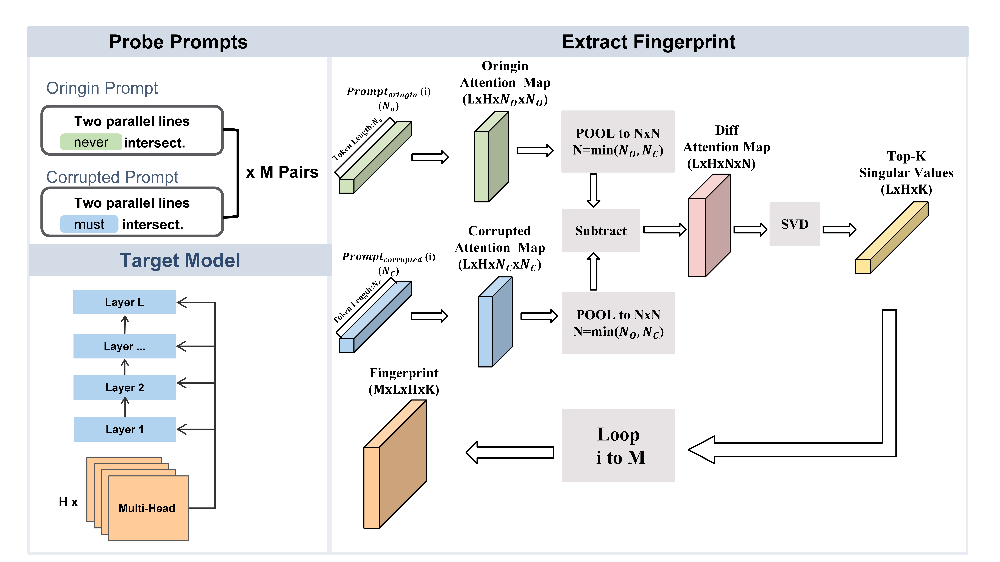
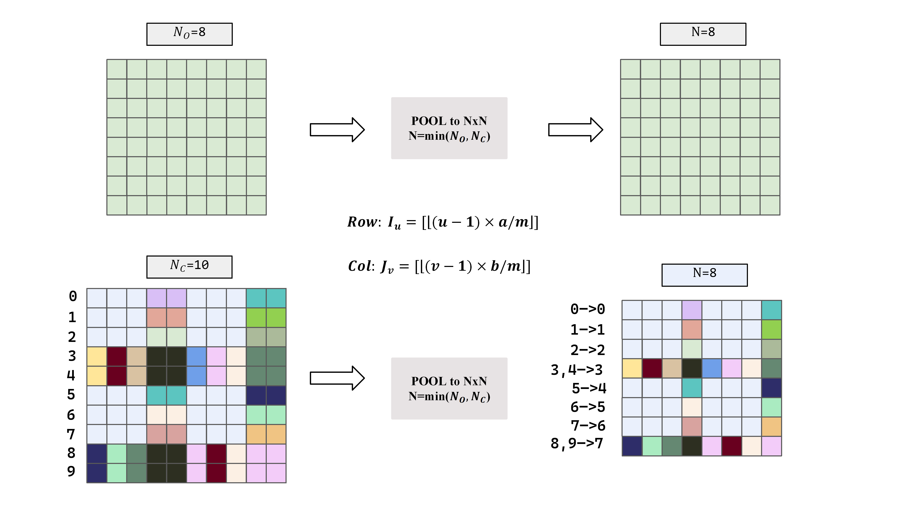

<div align="center">

# AttnDiff: Attention-based Differential Fingerprinting for Large Language Models

[](https://neurips.cc/)
[](https://arxiv.org/abs/2604.05502)
[](https://zhb0119.github.io/AttnDiff/)

[](https://www.python.org/)
[](https://pytorch.org/)
[](https://github.com/huggingface/transformers)
[](LICENSE)

**[Paper](https://arxiv.org/abs/2604.05502) · [Project Page](https://zhb0119.github.io/AttnDiff/) · [PDF](https://arxiv.org/pdf/2604.05502) · [Quick Start](#quick-start) · [Citation](#citation)**

</div>

## News

- **2026.09** — AttnDiff has been accepted to **NeurIPS 2026**!

## Introduction

AttnDiff is a **white-box, post-hoc fingerprinting method for LLM provenance verification**. It probes models with minimally edited prompt pairs, summarizes **head-level differential attention** with compact spectral descriptors, and compares fingerprints using **centered linear CKA**. It requires no model training or parameter modification and supports comparisons across different layer/head counts.

### Experiment Design at a Glance

The experiments test whether fingerprints remain similar for related derivatives while separating unrelated models. See the [project page](https://zhb0119.github.io/AttnDiff/#design) for an interactive overview.

| Design component | Paper protocol |
|---|---|
| **Controlled probes** | 60 original/corrupted prompt pairs; a single-word pivot changes semantic intent |
| **Domain coverage** | Code, Math, Economics, Medicine, Daily QA, and Safe Alignment; 10 pairs per domain |
| **Fingerprint** | All layers and heads; top-3 singular values per differential attention map; centered linear CKA |
| **Core robustness tests** | Fine-tuning (5M–700B tokens), weight/distribution merging, structured/unstructured pruning |
| **Extended tests** | PPO/DPO, eight merging recipes, pruning criteria, distillation, GPTQ quantization, MoE, and cross-family/scale comparisons |
| **Discriminability** | 36 related + 33 unrelated suspects in Section 5.6; AUROC/AUPR and fixed-threshold precision/recall/F1 |
| **Six baselines** | PCS, ICS, Logits, REEF, ProFlingo, and LLMMap |
| **Controlled ablations** | Differential mechanism, probe count/domain/length, spectral rank, and similarity metric |

### Selected Paper Results

| Evaluation | AttnDiff result | Source |
|---|---|---|
| Discriminability | **0.9883 AUROC / 0.9881 AUPR**; REEF: 0.9867 / 0.9877 | Table 4 |
| SFT robustness | Similarity **0.9856–0.9989** across six derivatives | Table 1 |
| Pruning robustness | Similarity **≥ 0.9879** across nine structured/unstructured pruned suspects | Table 3 |
| Differential ablation: related mean | Original attention **0.8817 → 0.9937** with differential attention | Table 11 |
| Differential ablation: unrelated mean | Original attention **0.3731 → 0.1647** with differential attention | Table 11 |

These are **paper-reported results**, not newly run experiments. Similarity scores are not accuracy. Table 11 uses a separate ablation subset (11 related + 8 unrelated models), rather than the 69-suspect discriminability pool. REEF remains competitive and has a slightly higher SFT mean (0.9966 vs. 0.9945).

### Pipeline Overview

<div align="center">


</div>

## Quick Start

### Installation

**Using uv (Recommended)**

```bash
# Install uv
curl -LsSf https://astral.sh/uv/install.sh | sh

# Clone and install
git clone https://github.com/zhb0119/AttnDiff.git
cd AttnDiff
uv sync
```

### Basic Usage

**Compute fingerprints:**

```bash
# Edit scripts/batch_compute.sh to configure models and device
bash scripts/batch_compute.sh
```

**Compare fingerprints:**

You can use pre-computed fingerprints provided in the repository:

```bash
uv run attndiff-compare \
  --base output/comput_W/fingerprint_Llama-2-7B.json \
  --dir output/comput_W \
  --cka linear
```

> **Note**: The repository includes pre-computed fingerprints for several open-source models in `output/comput_W/`. You can use these to quickly test the comparison functionality without computing fingerprints yourself.

---

## Contents

- [News](#news)
- [Introduction and experiment design](#introduction)
- [Quick Start](#quick-start)
- [Repository Structure](#repository-structure)
- [Dataset Format](#dataset-format)
- [Usage](#usage)
- [Experimental Evaluation](#experimental-evaluation)
- [Project Website](#project-website)
- [Citation](#citation)

---

## Repository Structure

```
AttnDiff/
├── src/attndiff/          # Package source code
│   ├── core/              # Core algorithms
│   ├── cli/               # CLI tools
│   └── utils/             # Utilities
├── tools/                 # Model manipulation tools
│   ├── model-merging/     # Model merging tools
│   └── model-pruning/     # Model pruning tools
├── scripts/               # Batch processing scripts
├── tests/                 # Unit tests
├── examples/              # Usage examples
├── dataset/               # Dataset directory
├── output/                # Output directory
│   ├── attention/         # Attention files
│   └── comput_W/          # Fingerprints
├── docs/                  # Static project website (GitHub Pages)
├── pyproject.toml         # UV/pip configuration
└── README.md
```

## Dataset Format

Create `dataset/dataset.json`:

```json
[
  {
    "id": 1,
    "topic": "Mathematics",
    "original": "...",
    "corrupted": "..."
  },
  {
    "id": 2,
    "topic": "Programming",
    "original": "...",
    "corrupted": "..."
  }
]
```

---

## Usage

### Compute Fingerprints

**Recommended: Use batch script**

```bash
# Edit scripts/batch_compute.sh to configure model paths and device
bash scripts/batch_compute.sh
```

**Advanced: Manual computation**

```bash
# From pre-extracted attention files
uv run attndiff-compute \
  --original output/attention/model_att_origin.json \
  --corrupted output/attention/model_att_perturb.json \
  --mode diff \
  --out output/comput_W/fingerprint_model.json

# Or let the tool auto-extract attentions from model
uv run attndiff-compute \
  --model_name /path/to/your/model \
  --attn_device cuda:0 \
  --mode diff \
  --out output/comput_W/fingerprint_your_model.json
```

**Arguments:**

| Argument | Description |
|----------|-------------|
| `--model_name` | Model name or local path |
| `--original` | Path to original attention JSON |
| `--corrupted` | Path to corrupted attention JSON |
| `--mode` | `diff` (default), `orig`, or `base` |
| `--attn_device` | Device for attention extraction (e.g., `cuda:0`) |
| `--out` | Output fingerprint path |

### Compare Fingerprints

```bash
# Compare all fingerprints in directory
uv run attndiff-compare \
  --base output/comput_W/fingerprint_base.json \
  --dir output/comput_W \
  --cka linear

# Compare specific layer
uv run attndiff-compare \
  --base output/comput_W/fingerprint_Llama-2-7B.json \
  --dir output/comput_W \
  --cka linear \
  --layer 1
```

**Arguments:**

| Argument | Description |
|----------|-------------|
| `--base` | Base fingerprint JSON (required) |
| `--dir` | Directory containing fingerprints |
| `--cka` | CKA type (`linear`) |
| `--layer` | Compare specific layer (1-based, optional) |

---

## Experimental Evaluation

AttnDiff has been systematically evaluated across multiple model manipulation dimensions to assess its robustness and effectiveness in model similarity estimation.

### Evaluation Dimensions

| Category | Type | Description | Methods/Variants |
|----------|------|-------------|------------------|
| **Fine-tuning** | Instruction | Instruction-tuned models | SFT, instruction alignment |
| **Preference Opt.** | PPO/DPO | Preference optimization | PPO-LoRA, DPO fine-tuning |
| **Model Merging** | Weight | Linear interpolation | Weight averaging, SLERP |
| | Distribution | Behavior-based merging | Task vectors, model soups |
| | [Mergekit](https://github.com/arcee-ai/mergekit) Strategies | Eight merging methods | Breadcrumbs, Ties, Della, Task, DARE+Ties, DARE+Task |
| **Model Pruning** | Structured | Layer/head removal | Sheared models, layer pruning |
| | Unstructured | Weight sparsification | Sparse models, magnitude pruning |
| | [LLM-Pruner](https://github.com/horseee/LLM-Pruner) | Importance-based | Random, L1 norm, Taylor importance |
| **Model Distillation** | Reasoning | Knowledge distillation | Open-R1, DeepSeek-R1 |
| | Logit-based | Output matching | Watermark distillation |
| **Quantization** | GPTQ | Post-training quantization | Int4, Int8 compression |
| **Cross-Family** | Architecture | Different model families | Llama, Qwen, Gemma, Mistral |
| | Scale | Model sizes | 1.5B, 2B, 7B, 8B, 14B parameters |
| **MoE** | Mixtral | Mixture of Experts | 8x7B sparse models |

<details>
<summary><strong>Full model taxonomy and repository links</strong></summary>

### Model Taxonomy

The following table categorizes all models used in experiments by their manipulation type:

| Category | Type | Base Model | Derivative Models |
|----------|------|------------|-------------------|
| **Fine-tuning** | Instruction | Llama-2-7B | Llama-2-finance-7b, Vicuna-1.5-7b, WizardMath-7b, Chinese-LLaMA-2-7b, CodeLLaMA-7b, Llemma-7b |
| **Preference Opt.** | PPO/DPO | Llama-2-7B | llama-2-7b-ppo-v0.1-reward, llama-2-7b-ppo-lora-v0.1, tulu-2-dpo-7b, llama2-7b-dpo |
| **Model Merging** | Weight | Shisa-gamma-7b-v1, WizardMath-7b-1.1, Abel-7b-002 | Evollm-jp-7b |
| | Distribution | Llama-2-7B, OpenLLaMA-2-7b, mpt-7b | Fusellm-7b |
| **Model Pruning** | Structured | Llama-2-7B | Sheared-llama-1.3b, Sheared-llama-1.3b-pruned, Sheared-llama-1.3b-sharegpt, Sheared-llama-2.7b, Sheared-llama-2.7b-pruned |
| | Unstructured | Llama-2-7B | Sparse-llama-2-7b, Wanda-llama-2-7b, GBLM-llama-2-7b |
| **Ablation** | Related | Llama-2-7B | CodeLlama-7b, Llama-2-finance-7B, Vicuna-7B-v1.5, Chinese-LLama-2-7B, WizardMath-7B-V1.0, llemma_7b, Sheared-LLaMA-1.3B, Sheared-LLaMA-1.3B-Pruned, Sheared-LLaMA-1.3B-ShareGPT, Sheared-LLaMA-2.7B, Sheared-LLaMA-2.7B-Pruned, Sheared-LLaMA-2.7B-ShareGPT, Sparse-llama-2-7b, Wanda-llama-2-7b, GBLM-llama-2-7b |
| | Unrelated | Llama-2-7B | Llama3-8B, mpt-7b, Qwen2.5-1.5B, Qwen2.5-3B, Qwen2.5-7B, Qwen2.5-14B, Qwen2.5-Math-7B, gemma-2-2b, Gemma-7B-it, Yi-6B |
| **Pilot** | Discovery | Llama-2-7B | Llama-2-7B, CodeLlama-7b-hf, WizardMath-7B-V1.0, llemma_7b, Qwen2.5-7B |
| **Model Distillation** | Reasoning | Llama-3.1-8B, Qwen2.5-7B, Qwen2.5-14B | Llama-3.1-8B-Instruct-Open-R1-Distill, Qwen2.5-7B-Open-R1-Distill, DeepSeek-R1-Distill-Qwen-14B |
| | Logit-based | Llama-2-7B | llama-2-7b-logit-watermark-distill-kgw-k1-gamma0.25-delta2 |
| **MoE** | Mixtral | Mixtral-8x7B | Instruct_Mixtral-8x7B-v0.1_Dolly15K, Nous-Hermes-2-Mixtral-8x7B-DPO, openbuddy-mixtral-8x7b-v15.4 |
| **Cross-Family** | Qwen2.5 | Qwen2.5-7B | Qwen2.5-Coder-1.5B, Qwen2.5-Math-1.5B, Qwen2.5-1.5B-Instruct |
| | | Qwen2.5-14B | Qwen2.5-14B-Instruct, oxy-1-small, Qwen2.5-14B-Gutenberg-Instruct-Slerpeno |
| | Gemma-2 | gemma-2-2b | gemma-2-2b-neogenes-ita, gemma-2-baku-2b, gemma2-2b-merged |
| | Mistral | Mistral-7B-v0.3 | AQUA-7B, spellcheck-mistral-7b, Mistral-7B-Instruct-demi-merge-v0.3-7B |
| **Quantization** | GPTQ | Qwen2.5-7B | Qwen2.5-7B-Instruct-GPTQ-Int8, Qwen/Qwen2.5-7B-Instruct-GPTQ-Int4 |
| | | Llama-2-7B | TheBloke/Llama-2-7B-Chat-GPTQ |
| | | Llama-3.1-8B | iqbalamo93/Meta-Llama-3.1-8B-Instruct-GPTQ-Q_8, DaraV/LLaMA-3.1-8B-Instruct-INT4-GPTQ |
| | | Mistral-7B-v0.3 | RedHatAI/Mistral-7B-Instruct-v0.3-GPTQ-4bit |

### Model Repository Links

The following table provides Hugging Face repository links for key models used in experiments:

| Category | Model Name | Repository URL |
|----------|------------|----------------|
| **Fine-tuning** | Llama-2-7b-ppo-lora | [renyiyu/llama-2-7b-ppo-lora-v0.1](https://huggingface.co/renyiyu/llama-2-7b-ppo-lora-v0.1) |
| | Tulu-2-dpo-7b | [allenai/tulu-2-dpo-7b](https://huggingface.co/allenai/tulu-2-dpo-7b) |
| | Llama2-7b-dpo | [mncai/llama2-7b-dpo-v1](https://huggingface.co/mncai/llama2-7b-dpo-v1) |
| **Model Merging** | Evollm-jp-7b | [huggingface.co/allenai/tulu-2-dpo-7b](https://huggingface.co/allenai/tulu-2-dpo-7b) |
| | Fusellm-7b | [huggingface.co/mncai/llama2-7b-dpo-v1](https://huggingface.co/mncai/llama2-7b-dpo-v1) |
| **Model Pruning** | Sheared-llama-1.3b | [princeton-nlp/Sheared-LLaMA-1.3B](https://huggingface.co/princeton-nlp/Sheared-LLaMA-1.3B) |
| | Sheared-llama-2.7b | [princeton-nlp/Sheared-LLaMA-2.7B](https://huggingface.co/princeton-nlp/Sheared-LLaMA-2.7B) |
| **Distillation** | Llama-3.1-8B-Open-R1-Distill | [asas-ai/Llama-3.1-8B-Instruct-Open-R1-Distill](https://huggingface.co/asas-ai/Llama-3.1-8B-Instruct-Open-R1-Distill) |
| | Qwen2.5-7B-Open-R1-Distill | [erickrus/Qwen2.5-7B-Open-R1-Distill](https://huggingface.co/erickrus/Qwen2.5-7B-Open-R1-Distill) |
| | DeepSeek-R1-Distill-Qwen-14B | [deepseek-ai/DeepSeek-R1-Distill-Qwen-14B](https://huggingface.co/deepseek-ai/DeepSeek-R1-Distill-Qwen-14B) |
| | Llama-2-7b-logit-watermark | [cygu/llama-2-7b-logit-watermark-distill-kgw-k1-gamma0.25-delta2](https://huggingface.co/cygu/llama-2-7b-logit-watermark-distill-kgw-k1-gamma0.25-delta2) |
| **MoE** | Instruct_Mixtral-8x7B-Dolly15K | [Brillibits/Instruct_Mixtral-8x7B-v0.1_Dolly15K](https://huggingface.co/Brillibits/Instruct_Mixtral-8x7B-v0.1_Dolly15K) |
| | Nous-Hermes-2-Mixtral-8x7B-DPO | [NousResearch/Nous-Hermes-2-Mixtral-8x7B-DPO](https://huggingface.co/NousResearch/Nous-Hermes-2-Mixtral-8x7B-DPO) |
| | Openbuddy-mixtral-8x7b-v15.4 | [openbuddy/openbuddy-mixtral-8x7b-v15.4](https://huggingface.co/openbuddy/openbuddy-mixtral-8x7b-v15.4) |
| **Cross-Family** | Qwen2.5-Coder-1.5B | [Qwen/Qwen2.5-Coder-1.5B](https://huggingface.co/Qwen/Qwen2.5-Coder-1.5B) |
| | Qwen2.5-Math-1.5B | [Qwen/Qwen2.5-Math-1.5B](https://huggingface.co/Qwen/Qwen2.5-Math-1.5B) |
| | Qwen2.5-1.5B-Instruct | [Qwen/Qwen2.5-1.5B-Instruct](https://huggingface.co/Qwen/Qwen2.5-1.5B-Instruct) |
| | Qwen2.5-14B-Instruct | [Qwen/Qwen2.5-14B-Instruct](https://huggingface.co/Qwen/Qwen2.5-14B-Instruct) |
| | Oxy-1-small | [oxyapi/oxy-1-small](https://huggingface.co/oxyapi/oxy-1-small) |
| | Qwen2.5-14B-Gutenberg-Instruct | [v000000/Qwen2.5-14B-Gutenberg-Instruct-Slerpeno](https://huggingface.co/v000000/Qwen2.5-14B-Gutenberg-Instruct-Slerpeno) |
| | Gemma-2-2b-neogenesis-ita | [anakin87/gemma-2-2b-neogenesis-ita](https://huggingface.co/anakin87/gemma-2-2b-neogenesis-ita) |
| | Gemma-2-baku-2b | [rinna/gemma-2-baku-2b](https://huggingface.co/rinna/gemma-2-baku-2b) |
| | Gemma2-2b-merged | [vonjack/gemma2-2b-merged](https://huggingface.co/vonjack/gemma2-2b-merged) |
| | AQUA-7B | [KurmaAI/AQUA-7B](https://huggingface.co/KurmaAI/AQUA-7B) |
| | Spellcheck-mistral-7b | [openfoodfacts/spellcheck-mistral-7b](https://huggingface.co/openfoodfacts/spellcheck-mistral-7b) |
| | Mistral-7B-Instruct-demi-merge | [grimjim/Mistral-7B-Instruct-demi-merge-v0.3-7B](https://huggingface.co/grimjim/Mistral-7B-Instruct-demi-merge-v0.3-7B) |
| **Quantization** | Qwen2.5-7B-Instruct-GPTQ-Int8 | [Qwen/Qwen2.5-7B-Instruct-GPTQ-Int8](https://huggingface.co/Qwen/Qwen2.5-7B-Instruct-GPTQ-Int8) |
| | Qwen2.5-7B-Instruct-GPTQ-Int4 | [Qwen/Qwen2.5-7B-Instruct-GPTQ-Int4](https://huggingface.co/Qwen/Qwen2.5-7B-Instruct-GPTQ-Int4) |
| | Llama-2-7B-Chat-GPTQ | [TheBloke/Llama-2-7B-Chat-GPTQ](https://huggingface.co/TheBloke/Llama-2-7B-Chat-GPTQ) |
| | Meta-Llama-3.1-8B-GPTQ-Q_8 | [iqbalamo93/Meta-Llama-3.1-8B-Instruct-GPTQ-Q_8](https://huggingface.co/iqbalamo93/Meta-Llama-3.1-8B-Instruct-GPTQ-Q_8) |
| | LLaMA-3.1-8B-INT4-GPTQ | [DaraV/LLaMA-3.1-8B-Instruct-INT4-GPTQ](https://huggingface.co/DaraV/LLaMA-3.1-8B-Instruct-INT4-GPTQ) |
| | Mistral-7B-v0.3-GPTQ-4bit | [RedHatAI/Mistral-7B-Instruct-v0.3-GPTQ-4bit](https://huggingface.co/RedHatAI/Mistral-7B-Instruct-v0.3-GPTQ-4bit) |

</details>

---

## Project Website

**Homepage:** [https://zhb0119.github.io/AttnDiff/](https://zhb0119.github.io/AttnDiff/)

The static website lives in [`docs/`](docs/). It presents the experimental protocol, interactive robustness comparisons, all six baselines, and key ablations. It can be published from this repository with GitHub Pages; **no separate `github.io` repository is needed**.

```bash
# Local preview
python -m http.server 8000 --directory docs
```

Open <http://localhost:8000>. For first-time publication, select **GitHub Actions** in the repository's **Settings → Pages**, then run the included **Deploy project website** workflow after pushing the website files. See the [deployment guide](docs/README.md).

## Citation

If you use AttnDiff in your research, please cite:

```bibtex
@misc{zhang2026attndiffattentionbaseddifferentialfingerprinting,
      title={AttnDiff: Attention-based Differential Fingerprinting for Large Language Models}, 
      author={Haobo Zhang and Zhenhua Xu and Junxian Li and Shangfeng Sheng and Dezhang Kong and Meng Han},
      year={2026},
      eprint={2604.05502},
      archivePrefix={arXiv},
      primaryClass={cs.CR},
      url={https://arxiv.org/abs/2604.05502}, 
}
```

## Contributing

Contributions are welcome! Please open an issue or pull request on GitHub.

## License

This project is licensed under the MIT License - see the [LICENSE](LICENSE) file for details.

## Acknowledgments

- Built with [PyTorch](https://pytorch.org/)
- Uses [Hugging Face Transformers](https://huggingface.co/transformers)
- Package management with [UV](https://github.com/astral-sh/uv)
