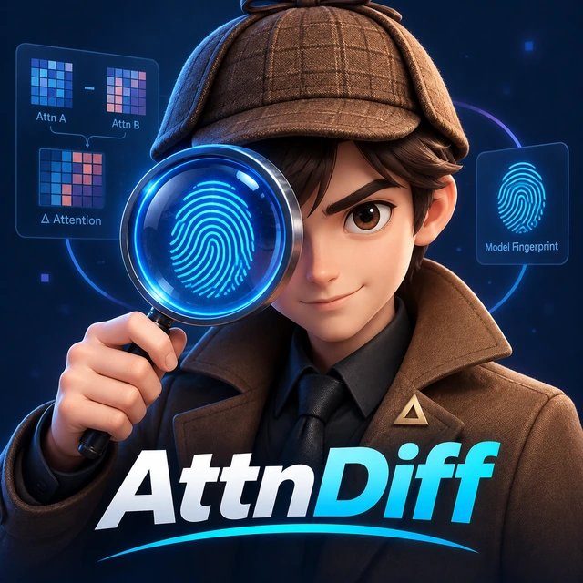
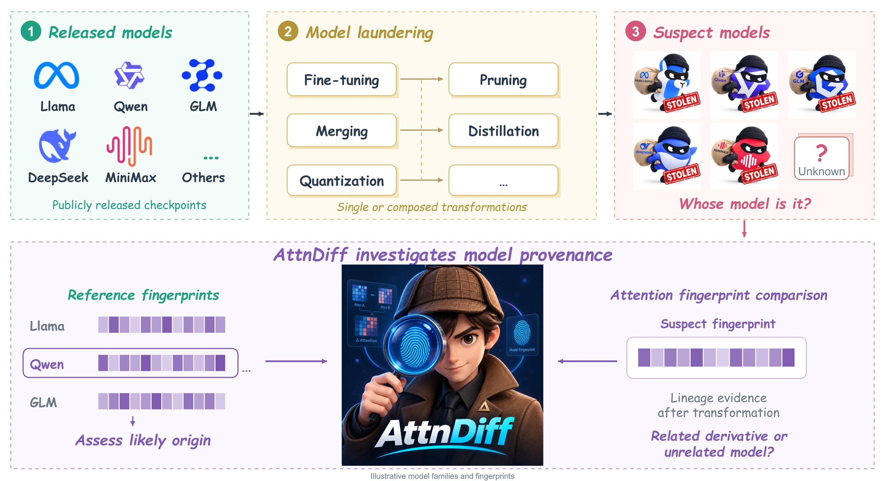
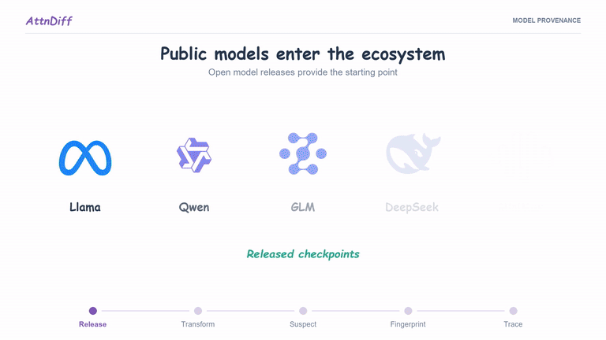
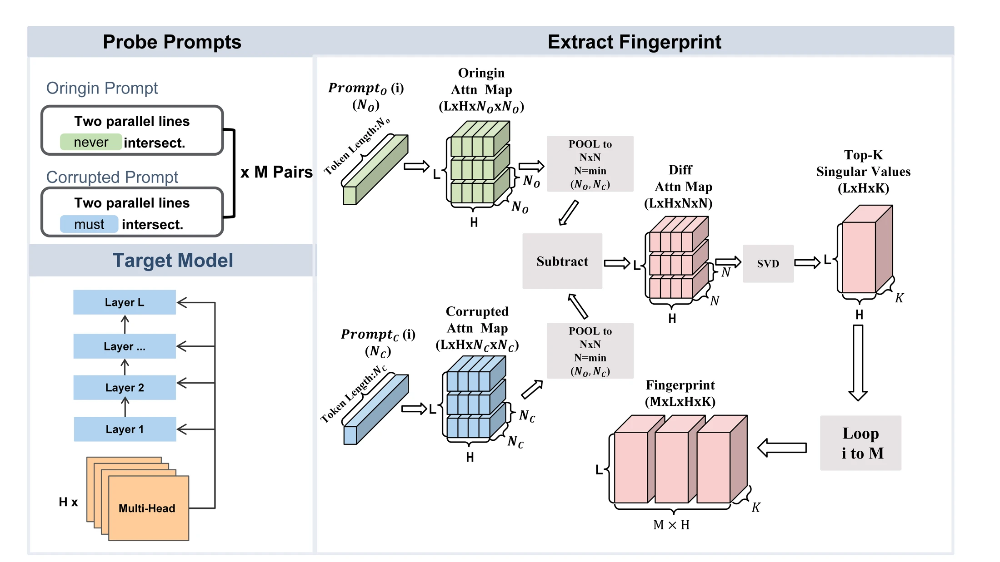

<div align="center">

<h1> AttnDiff</h1>

### Attention-based Differential Fingerprinting for Large Language Models

**NeurIPS 2026**

[](https://arxiv.org/abs/2604.05502)
[](https://zhb0119.github.io/AttnDiff/)
[](https://zhb0119.github.io/AttnDiff/#demo)
[](https://www.python.org/)
[](https://pytorch.org/)
[](LICENSE)

**Haobo Zhang**<sup>1,3,&#42;</sup> · **Zhenhua Xu**<sup>2,3,&#42;</sup> · **Junxian Li**<sup>4</sup><br>
**Shangfeng Sheng**<sup>5</sup> · **Dezhang Kong**<sup>2,3,†</sup> · **Meng Han**<sup>2,3,†</sup>

<sup>1</sup> Renmin University of China<br>
<sup>2</sup> Zhejiang University · <sup>3</sup> Binjiang Institute of Zhejiang University<br>
<sup>4</sup> Shanghai Jiao Tong University · <sup>5</sup> University of Science and Technology of China

<sup>&#42;</sup> Equal contribution &nbsp; <sup>†</sup> Corresponding authors<br>
[haobo0119@gmail.com](mailto:haobo0119@gmail.com) · [xuzhenhua0326@zju.edu.cn](mailto:xuzhenhua0326@zju.edu.cn) · [mhan@zju.edu.cn](mailto:mhan@zju.edu.cn)

**Trace model provenance through differential attention.**

<a href="docs/assets/teaser.png"></a>

<sub>Model families, fingerprint patterns, and the highlighted match are illustrative.</sub>

[Overview](#overview) · [Video](#video) · [Method](#method) · [Quick Start](#quick-start) · [Results](#results) · [Model Zoo](#models) · [Citation](#citation)

</div>

<a id="overview"></a>

## 🔎 Overview

AttnDiff is a **data-efficient, white-box** framework for verifying whether a suspect LLM derives from a reference model. It probes minimally edited prompt pairs that induce semantic conflicts, captures the resulting **attention differences**, summarizes them with **spectral descriptors**, and compares fingerprints using **centered linear CKA**.

- **Intrinsic fingerprints:** no watermark embedding, model training, or parameter modification.
- **Compact probes:** the paper defaults to 60 prompt pairs across six domains, with the top 3 singular values per layer/head.
- **Flexible comparison:** models can have different layer/head counts. CKA compares their geometry over the same ordered probes.
- **Broad evaluation:** fine-tuning, PPO/DPO, merging, pruning, distillation, quantization, cross-family comparisons, and a fixed-budget adaptive suppression pilot.

<a id="video"></a>

## 🎬 Video

<div align="center">
<a href="https://zhb0119.github.io/AttnDiff/#demo"></a>

**[▶ Video](https://zhb0119.github.io/AttnDiff/#demo)** · [Download MP4](https://raw.githubusercontent.com/zhb0119/AttnDiff/main/docs/assets/video/AttnDiff_story_20s_narrated.mp4)

<sub>English narration · English and Chinese subtitles on the project page</sub>
</div>

<a id="method"></a>

## 🧬 Method

<a href="docs/assets/pipeline.png"></a>

1. **Construct paired probes.** A single-word pivot creates a controlled semantic conflict: “parallel lines **never** intersect” → “parallel lines **always** intersect.”
2. **Extract attention.** Collect post-softmax causal self-attention maps across all layers and heads.
3. **Compute differences.** In the paper, adaptive average pooling aligns each pair to the smaller token length, then `ΔA = Pool(A_corrupted) − Pool(A_original)`.
4. **Build spectral fingerprints.** Keep the top `K = 3` singular values per layer/head and stack `M` probe descriptors into `F ∈ ℝ^(M × LHK)`.
5. **Compare models.** Independently extract both fingerprints using the **same probe identities and ordering**, then compare their centered `M × M` Gram matrices with linear CKA.

The method requires internal attention activations. Text-only APIs are outside the evaluated setting. Similarity provides evidence of shared lineage; decision thresholds should be calibrated for the model pool and verification setting.

<a id="quick-start"></a>

## 🚀 Quick Start

### Install

Install [uv](https://docs.astral.sh/uv/getting-started/installation/), then run:

```bash
git clone https://github.com/zhb0119/AttnDiff.git
cd AttnDiff
uv sync
```

Alternatively, use `python -m pip install -e .`. Run commands from the repository root. Multiline examples use Bash syntax; in PowerShell, use a single line or replace `\` with a backtick.

### Compare the included example fingerprints

```bash
uv run attndiff-compare \
  --base output/comput_W/fingerprint_Llama-2-7B.json \
  --dir output/comput_W \
  --cka linear
```

This compares stored fingerprints without loading model weights or extracting new attentions. These are example artifacts, not a complete reproduction of the paper experiments.

### Extract spectral fingerprints

Use a Hugging Face model identifier or local checkpoint path:

```bash
uv run attndiff-compute \
  --model_name /path/to/your/model \
  --attn_device cuda:0 \
  --mode diff \
  --svd_k 3 \
  --out output/spectral/fingerprint_your_model.json
```

The extractor reads `dataset/dataset.json` and can reuse attention JSONs under `output/attention/`. Use separate attention paths when changing probes so that old cached attentions are not reused.

To start from pre-extracted attention maps:

```bash
uv run attndiff-compute \
  --original output/attention/model_att_origin.json \
  --corrupted output/attention/model_att_perturb.json \
  --mode diff \
  --svd_k 3 \
  --out output/spectral/fingerprint_model.json
```

After extracting reference and suspect fingerprints into the same directory:

```bash
uv run attndiff-compare \
  --base output/spectral/fingerprint_reference.json \
  --dir output/spectral \
  --cka linear
```

Keep the same representation and ordered probe set across compared files. Use `--layer 1` for an optional layer-specific comparison (1-based).

| Extraction option | Purpose |
| --- | --- |
| `--model_name` | Model identifier or local checkpoint path |
| `--original`, `--corrupted` | Pre-extracted attention JSON files |
| `--mode diff` | Corrupted-minus-original attention |
| `--svd_k 3` | Enable top-3 singular-value descriptors |
| `--attn_device` | Extraction device, e.g. `cuda:0` |
| `--out` | Fingerprint output path |

For batch runs, configure model paths and device in [`scripts/batch_compute.sh`](scripts/batch_compute.sh), and add `--svd_k 3` to its extraction command to use spectral descriptors.

### Probe format and reproduction notes

The input is a JSON list:

```json
[
  {
    "id": 1,
    "topic": "Mathematics",
    "original": "In Euclidean geometry, two distinct parallel lines never intersect, no matter how far they are extended.",
    "corrupted": "In Euclidean geometry, two distinct parallel lines always intersect, no matter how far they are extended."
  }
]
```

- The checked-in `dataset/dataset.json` contains **30 pairs across five domains**. The paper defaults to **60 pairs across six domains**: Code, Math, Economics, Medicine, Daily QA, and Safe Alignment (10 pairs each).
- Set `--svd_k 3` explicitly: the current CLI does not enable spectral descriptors by default. Do not mix these outputs with legacy scalar fingerprints.
- For unequal token lengths, the current CLI's SVD path **crops** maps to the common minimum size; the paper method specifies **adaptive average pooling**. Exact reproduction requires resolving this implementation difference. Equal-length pairs do not need spatial alignment.

See the paper's implementation appendix for the protocol and [`dataset/README.md`](dataset/README.md) for the schema.

<a id="results"></a>

## 📊 Results

The following are **paper-reported results**, not measurements produced by the quick-start example.

| Evaluation | Reported result |
| --- | --- |
| Fine-tuning | CKA **0.9856–0.9989** across six Llama-2-7B derivatives |
| Pruning | CKA **≥ 0.9879** across nine structured/unstructured pruned suspects |
| Weight-space merging | CKA **0.9561–0.9996** to the evaluated parents |
| Discriminability | **0.9883 AUROC / 0.9881 AUPR**, on 36 related + 33 unrelated suspects |
| Adaptive suppression | Refreshed-probe CKA **0.988–0.991**, under 20–80% exposure and a fixed 96-step LoRA budget |

The adaptive study covers one related Gemma-2 model pair. Its findings support private, refreshed probes within that setting; they do not establish robustness to unrestricted adaptive attacks. AUROC/AUPR are ranking metrics, not accuracy percentages.

**[Explore interactive results and ablations →](https://zhb0119.github.io/AttnDiff/#results)**<br>
**[Browse model families and checkpoints →](#models)**

<a id="models"></a>

## 🗂️ Model Zoo

**56 catalog entries · 9 experiment categories**

Explore the model families and transformations evaluated in the paper. Each experiment uses its own subset; this directory is separate from the 36-related / 33-unrelated discriminability benchmark.

<table>
<tr>
<td width="33%" valign="top">
<h4>🧠 Fine-tuning</h4>
<p><b>6 entries</b><br><sub>Llama-2-Finance · Vicuna · CodeLLaMA</sub></p>
<a href="#models-fine">Explore models ↓</a>
</td>
<td width="33%" valign="top">
<h4>🎯 Preference optimization</h4>
<p><b>4 entries</b><br><sub>PPO · PPO-LoRA · Tulu-2-DPO</sub></p>
<a href="#models-preference">Explore models ↓</a>
</td>
<td width="33%" valign="top">
<h4>🔀 Model merging</h4>
<p><b>2 entries</b><br><sub>EvoLLM-JP · FuseLLM</sub></p>
<a href="#models-merge">Explore models ↓</a>
</td>
</tr>
<tr>
<td width="33%" valign="top">
<h4>✂️ Model pruning</h4>
<p><b>9 entries</b><br><sub>Sheared-LLaMA · Sparse · Wanda</sub></p>
<a href="#models-prune">Explore models ↓</a>
</td>
<td width="33%" valign="top">
<h4>🌐 Cross-family &amp; scale</h4>
<p><b>12 entries</b><br><sub>Qwen2.5 · Gemma-2 · Mistral</sub></p>
<a href="#models-cross">Explore models ↓</a>
</td>
<td width="33%" valign="top">
<h4>🧪 Distillation</h4>
<p><b>4 entries</b><br><sub>Open-R1 · DeepSeek-R1 · Logit distillation</sub></p>
<a href="#models-distill">Explore models ↓</a>
</td>
</tr>
<tr>
<td width="33%" valign="top">
<h4>🧩 Mixture of experts</h4>
<p><b>3 entries</b><br><sub>Mixtral · Nous-Hermes · OpenBuddy</sub></p>
<a href="#models-moe">Explore models ↓</a>
</td>
<td width="33%" valign="top">
<h4>⚡ Quantization</h4>
<p><b>6 entries</b><br><sub>GPTQ · Llama · Qwen · Mistral</sub></p>
<a href="#models-quant">Explore models ↓</a>
</td>
<td width="33%" valign="top">
<h4>🔬 Unrelated controls</h4>
<p><b>10 entries</b><br><sub>Llama-3 · MPT · Qwen · Gemma · Yi</sub></p>
<a href="#models-control">Explore models ↓</a>
</td>
</tr>
</table>

<a id="models-fine"></a>

<details open>
<summary><b>🧠 Fine-tuning · 6 entries</b></summary>

| Model | Reference / source |
| :--- | :--- |
| Llama-2-finance-7b | Llama-2-7B |
| Vicuna-1.5-7b | Llama-2-7B |
| WizardMath-7b | Llama-2-7B |
| Chinese-LLaMA-2-7b | Llama-2-7B |
| CodeLLaMA-7b | Llama-2-7B |
| Llemma-7b | Llama-2-7B |

</details>

<a id="models-preference"></a>

<details>
<summary><b>🎯 Preference optimization · 4 entries</b></summary>

| Model | Reference / source |
| :--- | :--- |
| llama-2-7b-ppo-v0.1-reward | Llama-2-7B |
| [llama-2-7b-ppo-lora-v0.1](https://huggingface.co/renyiyu/llama-2-7b-ppo-lora-v0.1) | Llama-2-7B |
| [tulu-2-dpo-7b](https://huggingface.co/allenai/tulu-2-dpo-7b) | Llama-2-7B |
| [llama2-7b-dpo](https://huggingface.co/mncai/llama2-7b-dpo-v1) | Llama-2-7B |

</details>

<a id="models-merge"></a>

<details>
<summary><b>🔀 Model merging · 2 entries</b></summary>

| Model | Reference / source |
| :--- | :--- |
| [Evollm-jp-7b](https://huggingface.co/SakanaAI/EvoLLM-JP-v1-7B) | Shisa-gamma-7b-v1<br>WizardMath-7b-1.1<br>Abel-7b-002 |
| [Fusellm-7b](https://huggingface.co/Wanfq/FuseLLM-7B) | Llama-2-7B<br>OpenLLaMA-2-7b<br>mpt-7b |

</details>

<a id="models-prune"></a>

<details>
<summary><b>✂️ Model pruning · 9 entries</b></summary>

| Model | Reference / source |
| :--- | :--- |
| [Sheared-LLaMA-1.3B](https://huggingface.co/princeton-nlp/Sheared-LLaMA-1.3B) | Llama-2-7B |
| Sheared-LLaMA-1.3B-pruned | Llama-2-7B |
| Sheared-LLaMA-1.3B-sharegpt | Llama-2-7B |
| [Sheared-LLaMA-2.7B](https://huggingface.co/princeton-nlp/Sheared-LLaMA-2.7B) | Llama-2-7B |
| Sheared-LLaMA-2.7B-pruned | Llama-2-7B |
| Sheared-LLaMA-2.7B-sharegpt | Llama-2-7B |
| Sparse-llama-2-7b | Llama-2-7B |
| Wanda-llama-2-7b | Llama-2-7B |
| GBLM-llama-2-7b | Llama-2-7B |

</details>

<a id="models-cross"></a>

<details>
<summary><b>🌐 Cross-family & scale · 12 entries</b></summary>

| Model | Reference / source |
| :--- | :--- |
| [Qwen2.5-Coder-1.5B](https://huggingface.co/Qwen/Qwen2.5-Coder-1.5B) | Qwen2.5-1.5B |
| [Qwen2.5-Math-1.5B](https://huggingface.co/Qwen/Qwen2.5-Math-1.5B) | Qwen2.5-1.5B |
| [Qwen2.5-1.5B-Instruct](https://huggingface.co/Qwen/Qwen2.5-1.5B-Instruct) | Qwen2.5-1.5B |
| [Qwen2.5-14B-Instruct](https://huggingface.co/Qwen/Qwen2.5-14B-Instruct) | Qwen2.5-14B |
| [oxy-1-small](https://huggingface.co/oxyapi/oxy-1-small) | Qwen2.5-14B |
| [Qwen2.5-14B-Gutenberg-Instruct-Slerpeno](https://huggingface.co/v000000/Qwen2.5-14B-Gutenberg-Instruct-Slerpeno) | Qwen2.5-14B |
| [gemma-2-2b-neogenesis-ita](https://huggingface.co/anakin87/gemma-2-2b-neogenesis-ita) | gemma-2-2b |
| [gemma-2-baku-2b](https://huggingface.co/rinna/gemma-2-baku-2b) | gemma-2-2b |
| [gemma2-2b-merged](https://huggingface.co/vonjack/gemma2-2b-merged) | gemma-2-2b |
| [AQUA-7B](https://huggingface.co/KurmaAI/AQUA-7B) | Mistral-7B-v0.3 |
| [spellcheck-mistral-7b](https://huggingface.co/openfoodfacts/spellcheck-mistral-7b) | Mistral-7B-v0.3 |
| [Mistral-7B-Instruct-demi-merge-v0.3-7B](https://huggingface.co/grimjim/Mistral-7B-Instruct-demi-merge-v0.3-7B) | Mistral-7B-v0.3 |

</details>

<a id="models-distill"></a>

<details>
<summary><b>🧪 Distillation · 4 entries</b></summary>

| Model | Reference / source |
| :--- | :--- |
| [Llama-3.1-8B-Instruct-Open-R1-Distill](https://huggingface.co/asas-ai/Llama-3.1-8B-Instruct-Open-R1-Distill) | Llama-3.1-8B |
| [Qwen2.5-7B-Open-R1-Distill](https://huggingface.co/erickrus/Qwen2.5-7B-Open-R1-Distill) | Qwen2.5-7B |
| [DeepSeek-R1-Distill-Qwen-14B](https://huggingface.co/deepseek-ai/DeepSeek-R1-Distill-Qwen-14B) | Qwen2.5-14B |
| [llama-2-7b-logit-watermark-distill-kgw-k1-gamma0.25-delta2](https://huggingface.co/cygu/llama-2-7b-logit-watermark-distill-kgw-k1-gamma0.25-delta2) | Llama-2-7B |

</details>

<a id="models-moe"></a>

<details>
<summary><b>🧩 Mixture of experts · 3 entries</b></summary>

| Model | Reference / source |
| :--- | :--- |
| [Instruct_Mixtral-8x7B-v0.1_Dolly15K](https://huggingface.co/Brillibits/Instruct_Mixtral-8x7B-v0.1_Dolly15K) | Mixtral-8x7B |
| [Nous-Hermes-2-Mixtral-8x7B-DPO](https://huggingface.co/NousResearch/Nous-Hermes-2-Mixtral-8x7B-DPO) | Mixtral-8x7B |
| [openbuddy-mixtral-8x7b-v15.4](https://huggingface.co/openbuddy/openbuddy-mixtral-8x7b-v15.4) | Mixtral-8x7B |

</details>

<a id="models-quant"></a>

<details>
<summary><b>⚡ Quantization · 6 entries</b></summary>

| Model | Reference / source |
| :--- | :--- |
| [Qwen2.5-7B-Instruct-GPTQ-Int8](https://huggingface.co/Qwen/Qwen2.5-7B-Instruct-GPTQ-Int8) | Qwen2.5-7B |
| [Qwen2.5-7B-Instruct-GPTQ-Int4](https://huggingface.co/Qwen/Qwen2.5-7B-Instruct-GPTQ-Int4) | Qwen2.5-7B |
| [Llama-2-7B-Chat-GPTQ](https://huggingface.co/TheBloke/Llama-2-7B-Chat-GPTQ) | Llama-2-7B |
| [Meta-Llama-3.1-8B-Instruct-GPTQ-Q_8](https://huggingface.co/iqbalamo93/Meta-Llama-3.1-8B-Instruct-GPTQ-Q_8) | Llama-3.1-8B |
| [LLaMA-3.1-8B-Instruct-INT4-GPTQ](https://huggingface.co/DaraV/LLaMA-3.1-8B-Instruct-INT4-GPTQ) | Llama-3.1-8B |
| [Mistral-7B-Instruct-v0.3-GPTQ-4bit](https://huggingface.co/RedHatAI/Mistral-7B-Instruct-v0.3-GPTQ-4bit) | Mistral-7B-v0.3 |

</details>

<a id="models-control"></a>

<details>
<summary><b>🔬 Unrelated controls · 10 entries</b></summary>

| Model | Compared against |
| :--- | :--- |
| Llama3-8B | Llama-2-7B |
| mpt-7b | Llama-2-7B |
| Qwen2.5-1.5B | Llama-2-7B |
| Qwen2.5-3B | Llama-2-7B |
| Qwen2.5-7B | Llama-2-7B |
| Qwen2.5-14B | Llama-2-7B |
| Qwen2.5-Math-7B | Llama-2-7B |
| gemma-2-2b | Llama-2-7B |
| Gemma-7B-it | Llama-2-7B |
| Yi-6B | Llama-2-7B |

</details>

[🔎 Search all models on the project page](https://zhb0119.github.io/AttnDiff/#models) · [Full taxonomy & checkpoint directory](docs/model-zoo.md)

## 📁 Repository

```text
AttnDiff/
├── src/attndiff/       # Fingerprint extraction, similarity, and CLI
├── dataset/           # Example paired probes
├── output/comput_W/   # Included example fingerprints
├── scripts/           # Batch processing
├── tools/             # Model merging and pruning utilities
├── examples/          # Usage examples
├── tests/             # Algorithm tests
├── docs/              # GitHub Pages source and paper media
├── CITATION.cff       # GitHub citation metadata
└── pyproject.toml     # Package configuration
```

Project-page maintenance and local preview: [`docs/README.md`](docs/README.md).

<a id="citation"></a>

## 📝 Citation

```bibtex
@misc{zhang2026attndiffattentionbaseddifferentialfingerprinting,
  title={AttnDiff: Attention-based Differential Fingerprinting for Large Language Models},
  author={Haobo Zhang and Zhenhua Xu and Junxian Li and Shangfeng Sheng and Dezhang Kong and Meng Han},
  year={2026},
  eprint={2604.05502},
  archivePrefix={arXiv},
  primaryClass={cs.CR},
  url={https://arxiv.org/abs/2604.05502}
}
```

## License and Acknowledgments

Code is released under the [MIT License](LICENSE). Built with [PyTorch](https://pytorch.org/), [Hugging Face Transformers](https://huggingface.co/transformers), and [uv](https://github.com/astral-sh/uv).
